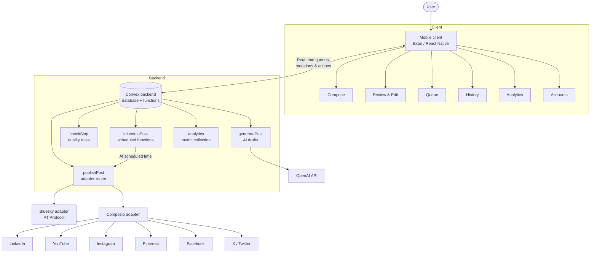

<div align="center">
  

  # UniPost

  ### A Unified Multi-Platform Social Media Management, Scheduling and Analytics Application

  **Create once. Publish everywhere.**

  
  
  
  
  
  

  **Minor Project · B.Tech. (AI & DS), 7th Semester · Academic Year 2026–27**

  School of Engineering & Technology<br/>
  Vivekananda Institute of Professional Studies – Technical Campus<br/>
  Pitampura, Delhi – 110034
</div>

---

## Project Team

| Name | Role |
| --- | --- |
| **Abu Maaz** | Team member |
| **Md Moin Akhtar** | Team member |
| **Prem Maheshwari** | Team member |
| **Lakshay Chakravarti** | Team member |

**Project Supervisor:** Dr. Sonakshi Vij

---

## Table of Contents

1. [Abstract](#abstract)
2. [Problem Statement](#problem-statement)
3. [Objectives](#objectives)
4. [Key Features](#key-features)
5. [System Architecture](#system-architecture)
6. [Logical Modules](#logical-modules)
7. [Technology Stack](#technology-stack)
8. [Data Model](#data-model)
9. [Application Screens](#application-screens)
10. [Getting Started](#getting-started)
11. [Security and Privacy](#security-and-privacy)
12. [Testing and Validation](#testing-and-validation)
13. [Feasibility](#feasibility)
14. [Limitations and Future Scope](#limitations-and-future-scope)
15. [Project Structure](#project-structure)
16. [References](#references)
17. [License](#license)

---

## Abstract

Social media is now a primary channel for communication, marketing and community building. Creators and small teams, however, often run accounts on several networks at once, and every network has its own login flow, publishing interface, media rules, scheduling options and analytics dashboard. The same post is copied by hand into many apps, scheduled in separate calendars, and its performance is tracked in separate dashboards.

**UniPost** is a mobile-first application that brings this work into one workspace. A user writes one idea, picks destination platforms, reviews AI-assisted platform-specific drafts (or submits their own final copy unchanged), and then publishes immediately or schedules each post. Internally, the system keeps one common content object and passes it through a **per-platform adapter** that converts it into the format each network expects. Published posts are tracked through a status timeline, and permitted engagement metrics are collected into a single normalized analytics view.

The working prototype supports **Bluesky, LinkedIn, YouTube, Instagram, Pinterest, Facebook and X (Twitter)**, and new networks can be added through the same adapter interface. The project aligns with **UN Sustainable Development Goal 9 (Industry, Innovation and Infrastructure)** by providing reusable digital infrastructure that improves the productivity of creators, small organizations and digital teams.

---

## Problem Statement

Users and teams managing several social-media identities face a fragmented workflow:

- Content is repeatedly copied into different applications, and media is uploaded multiple times.
- Platform-specific fields (titles, character limits, media requirements) must be remembered manually.
- Scheduled posts are spread across separate calendars.
- After publishing, engagement data is scattered across independent dashboards.
- Team use adds risks such as credential sharing, duplicate posting and unclear ownership.

**The core problem** is to operate multiple social-media accounts securely from one mobile application, while respecting each platform's rules and keeping one scheduling and analytics workflow.

---

## Objectives

1. **Secure account linking** — connect multiple accounts through official authentication mechanisms (OAuth 2.0 / app passwords) instead of storing social-media passwords.
2. **Unified composition** — create one draft, select target platforms, and support captions, media, titles and platform-specific fields.
3. **Immediate and scheduled publishing** — with job status, retry handling and publish-history records.
4. **Consolidated analytics** — aggregate permitted metrics such as likes, reposts, comments and views into one normalized dashboard.
5. **Content quality and suggestions** — generate platform-aware drafts and flag low-quality or repetitive writing without silently rewriting the user's work.

---

## Key Features

| Feature | Description |
| --- | --- |
| **Unified composer** | Enter one idea (with optional photo or video) and choose any combination of supported platforms. |
| **AI-assisted platform drafts** | Generates a separate draft for each platform that respects its tone, length and structure (for example, a title and description for YouTube). |
| **"Use my own copy" mode** | Skip generation and publish the user's final text exactly as written. |
| **Human approval by default** | Every platform draft can be reviewed and edited before anything is published. |
| **Writing-quality guardrails** | A deterministic rule engine flags repetitive, artificial or low-quality phrasing with the exact quote, the rule broken and a suggestion. |
| **Publish now or schedule** | Publish immediately, or choose a separate time for each platform. Scheduled posts can be cancelled. |
| **Publishing history** | A chronological timeline of scheduled, published and failed posts, with links to live posts and one-tap retry for failures. |
| **Normalized analytics** | Collects engagement metrics into one consistent model, keeping every poll so trends over time are visible. |
| **Account manager** | Connect and disconnect social accounts from one screen. |
| **Fallback image generation** | For image-only platforms such as Instagram, an image can be generated from the post text when no media is attached. |

---

## System Architecture



### Content workflow

```text
Idea or final copy
        │
        ▼
Platform selection ──► Platform-aware drafts ──► Quality check
        │                                            │
        │                                            ▼
        └──────────────────────────────────► Review and edit
                                                     │
                                         ┌───────────┴───────────┐
                                         ▼                       ▼
                                    Publish now              Schedule
                                         │                       │
                                         └───────────┬───────────┘
                                                     ▼
                                          History and analytics
```

### Adapter-per-platform design

Every network differs in authentication, media workflow, rate limits and account eligibility. UniPost hides these differences behind one routing layer: `publishPost` receives the common content object and dispatches it to the matching adapter, which validates the content, calls the platform's official API and returns a normalized result (live URL or a readable error). Adding a new network only means adding a new adapter — the composer, scheduler and history screens do not change.

---

## Logical Modules

| # | Module | Implementation |
| --- | --- | --- |
| 1 | **Mobile user interface** | `App.tsx`, `src/screens/*`, `src/components/*` |
| 2 | **Authentication / account service** | `convex/connections.ts` — connect, check and disconnect platform accounts |
| 3 | **Platform-integration adapters** | `convex/publishPost.ts`, `convex/lib/bluesky.ts`, `convex/lib/composio.ts` |
| 4 | **Scheduling and background jobs** | `convex/schedulePost.ts` using Convex scheduled functions |
| 5 | **Analytics collection and normalization** | `convex/analytics.ts`, `convex/lib/analytics.ts` |
| 6 | **Content generation and quality** | `convex/generatePost.ts`, `convex/checkSlop.ts`, `convex/lib/imageGen.ts` |

---

## Technology Stack

| Layer | Technology | Purpose |
| --- | --- | --- |
| Mobile client | **Expo SDK 54, React Native 0.81, TypeScript** | Single codebase for Android, iOS and the web |
| Backend and database | **Convex** | Real-time document database, server functions and file storage |
| Scheduling | **Convex scheduled functions** | Runs each scheduled publish at its chosen time, with no separate queue server |
| Bluesky integration | **AT Protocol** | Direct posting using a revocable app password |
| Other platform integrations | **Composio** | Managed OAuth connections and API calls for LinkedIn, YouTube, Instagram, Pinterest, Facebook and X |
| Content generation | **OpenAI API** | Platform-aware drafts and fallback image generation |
| Media selection | **Expo Image Picker** | Photo and video attachments |
| Web deployment | **Vercel** | Static hosting of the web build |

> **Note on the technology choice:** The synopsis proposed Flutter, FastAPI, PostgreSQL and Redis/Celery. During development the team moved to **Expo/React Native + Convex**, which provides the same capabilities (cross-platform client, REST-style backend functions, a database, background scheduling) in a single TypeScript codebase. This removed the need to run and connect separate API, database and queue servers, and made real-time status updates in the app straightforward. The modular, adapter-per-platform architecture from the synopsis was kept unchanged.

---

## Data Model

| Table | Purpose | Key fields |
| --- | --- | --- |
| `posts` | The common content object created once per idea | `brief`, `mediaType`, `mediaStorageId`, `createdAt` |
| `platformPosts` | One row per destination platform | `platform`, `generatedText`, `finalText`, `youtubeTitle`, `slopFindings`, `status`, `url`, `error`, `scheduledFor`, `publishedAt` |
| `postMetrics` | Every analytics poll, kept as history | `platformPostId`, `platform`, `likes`, `reposts`, `comments`, `views`, `fetchedAt` |

A platform post moves through these states:

```text
draft ──► approved ──► publishing ──► published
              │                  └──► failed ──► (retry)
              └──► scheduled ──► publishing ──► …
```

---

## Application Screens

| Screen | Purpose |
| --- | --- |
| **Compose** | Enter the idea, attach media and choose destination platforms. |
| **Review** | Edit each platform draft, see quality findings, then publish or schedule. |
| **Queue** | View and cancel upcoming scheduled posts. |
| **History** | Timeline of published and failed posts with live links and retry. |
| **Analytics** | Normalized engagement metrics across platforms. |
| **Accounts** | Connect and disconnect social-media accounts. |

---

## Getting Started

### Prerequisites

- Node.js 20 or later and npm
- (Optional) A Convex account — not needed for local development
- (Optional) Expo Go on a phone, or an Android emulator / iOS simulator
- API credentials for the integrations you want to enable (OpenAI, Bluesky, Composio)

### 1. Install

```bash
git clone https://github.com/somewherelostt/UniPost.git
cd UniPost
npm install
```

### 2. Start the backend

Run Convex locally without an account:

```bash
CONVEX_AGENT_MODE=anonymous npx convex dev
```

Or, with a Convex account, run `npx convex dev` and follow the prompts. Either way, this writes the backend URL to `.env.local` and keeps the functions in sync while it runs.

### 3. Configure credentials

All secrets are stored in the Convex server environment, never in the app:

```bash
npx convex env set OPENAI_API_KEY your_openai_api_key
npx convex env set BLUESKY_HANDLE your_handle.bsky.social
npx convex env set BLUESKY_APP_PASSWORD your_app_password
npx convex env set COMPOSIO_API_KEY your_composio_api_key
```

Platform connection setup is explained in [`docs/composio-setup.md`](docs/composio-setup.md).

### 4. Run the app

In a second terminal:

```bash
npm start
```

Then press `w` for the web, `a` for Android, `i` for iOS, or scan the QR code with Expo Go. Shortcuts:

```bash
npm run web
npm run android
npm run ios
```

### 5. Build for the web

```bash
npm run build:web
```

The static site is written to `dist/` and can be deployed to Vercel using the included `vercel.json`.

---

## Security and Privacy

- **No social-media passwords are stored.** Accounts are linked through OAuth (via Composio) or a revocable Bluesky app password.
- **Secrets stay server-side.** API keys exist only in the Convex environment and are never bundled into the mobile app.
- **Official APIs only.** Publishing uses supported platform APIs — no scraping or browser automation.
- **Human in the loop.** Nothing is published until the user reviews and approves it.
- **Normalized errors.** Third-party errors are converted into clear messages before reaching the interface.
- **Secure transport.** All production traffic uses HTTPS.

---

## Testing and Validation

Type-check the whole project:

```bash
npx tsc --noEmit --pretty false
```

Each feature was built against written acceptance checks ("gates"), recorded with evidence in [`GATES.md`](GATES.md) and the [`gates/`](gates/) folder:

| Gate file | What it validates |
| --- | --- |
| `gates/bluesky.md` | Bluesky authentication and publishing |
| `gates/composio.md` | Account connection and publishing for other platforms |
| `gates/generatepost.md` | Platform-aware draft generation |
| `gates/checkslop.md` | The quality rule engine catches every banned pattern and does not flag clean text |
| `gates/client-screens.md` | Client screens and navigation |

The root gates also verify that the project type-checks cleanly, the backend deploys without errors, the app bundles without import errors, and no secret appears anywhere in the source code.

---

## Feasibility

- **Technical:** Major networks expose authenticated developer APIs for publishing and analytics. Platform differences are isolated behind adapters, so each network can be tested independently.
- **Operational:** The user flow is simpler than the current multi-app process — connect accounts once, write a post, choose destinations, and choose "now" or a scheduled time.
- **Economic:** Built on open-source frameworks and managed services with free tiers. No special hardware is needed; the main variable cost is external API usage.
- **Security and policy:** Passwords are never stored, secrets are kept server-side, and only official, permitted APIs are used.

---

## Limitations and Future Scope

**Current limitations**

- Analytics collection currently covers **Bluesky and Facebook**, where post identifiers can be reliably mapped back to metrics. Other platforms depend on the data their APIs return after publishing.
- Some platforms restrict API access by account type, app review status or quotas, so availability can vary per account.

**Future scope**

- Personal and team **workspaces with role-based access**, so collaborators can draft and review without raw account access.
- **Data-driven topic suggestions** that rank past content by performance.
- Analytics for YouTube, LinkedIn and the remaining platforms.
- A calendar view of scheduled content.
- Additional networks (for example Threads) through the same adapter interface.

---

## Project Structure

```text
UniPost/
├── App.tsx                 Application shell and tab navigation
├── index.ts                Application entry point
├── app.json                Expo configuration
├── assets/                 App icons and splash assets
├── src/
│   ├── screens/            Compose, Review, Queue, History, Analytics, Accounts
│   ├── components/         Shared UI components (platform badges, status pills)
│   ├── theme.ts            Design tokens
│   └── types.ts            Shared types
├── convex/
│   ├── schema.ts           Database schema
│   ├── queries.ts          Queries and mutations
│   ├── generatePost.ts     AI draft generation
│   ├── checkSlop.ts        Writing-quality rule engine
│   ├── publishPost.ts      Publishing router (adapter dispatch)
│   ├── schedulePost.ts     Scheduling and cancellation
│   ├── connections.ts      Account connection management
│   ├── analytics.ts        Metric refresh
│   └── lib/                Bluesky, Composio, analytics and image adapters
├── docs/                   Specifications and integration guides
├── gates/                  Feature acceptance checks
├── GATES.md                Root validation record
└── PLAN.md                 Implementation plan and history
```

### Further documentation

- [`docs/spec-v0.md`](docs/spec-v0.md) — initial product specification
- [`docs/spec-v1.md`](docs/spec-v1.md) — analytics and learning-system direction
- [`docs/spec-v1-postbridge-parity.md`](docs/spec-v1-postbridge-parity.md) — extended product research
- [`docs/composio-setup.md`](docs/composio-setup.md) — platform integration setup
- [`PLAN.md`](PLAN.md) — implementation plan and project history

---

## References

1. A. M. Kaplan and M. Haenlein, "Users of the world, unite! The challenges and opportunities of Social Media," *Business Horizons*, vol. 53, no. 1, pp. 59–68, 2010, doi: 10.1016/j.bushor.2009.09.003.
2. B. Batrinca and P. C. Treleaven, "Social media analytics: a survey of techniques, tools and platforms," *AI & Society*, vol. 30, no. 1, pp. 89–116, 2015, doi: 10.1007/s00146-014-0549-4.
3. S. Stieglitz, M. Mirbabaie, B. Ross, and C. Neuberger, "Social media analytics – Challenges in topic discovery, data collection, and data preparation," *International Journal of Information Management*, vol. 39, pp. 156–168, 2018, doi: 10.1016/j.ijinfomgt.2017.12.002.
4. K. Peters, Y. Chen, A. M. Kaplan, B. Ognibeni, and K. Pauwels, "Social Media Metrics – A Framework and Guidelines for Managing Social Media," *Journal of Interactive Marketing*, vol. 27, no. 4, pp. 281–298, 2013, doi: 10.1016/j.intmar.2013.09.007.
5. Hootsuite, "Social Media Management and Scheduling Platform." [Online]. Available: https://www.hootsuite.com/
6. Buffer, "Social Media Management Platform." [Online]. Available: https://buffer.com/
7. Microsoft, "LinkedIn Posts API," Microsoft Learn. [Online]. Available: https://learn.microsoft.com/en-us/linkedin/marketing/community-management/shares/posts-api
8. Google, "YouTube Data API v3 – API Reference." [Online]. Available: https://developers.google.com/youtube/v3/docs
9. X Corp., "Create or Edit Post – X API." [Online]. Available: https://docs.x.com/x-api/posts/create-post
10. Pinterest, "Create boards and Pins – Pinterest Developers." [Online]. Available: https://developers.pinterest.com/docs/work-with-organic-content-and-users/create-boards-and-pins/
11. Bluesky, "Posting via the Bluesky API." [Online]. Available: https://docs.bsky.app/blog/create-post
12. Meta Platforms, "Meta for Developers – Social APIs and Platform Documentation." [Online]. Available: https://developers.facebook.com/docs/

---

## License

Distributed under the MIT License. See [`LICENSE`](LICENSE) for details.

---

<div align="center">
  <b>UniPost</b> — Minor Project, B.Tech. (AI & DS), VIPS-TC, 2026–27<br/>
  Abu Maaz · Md Moin Akhtar · Prem Maheshwari · Lakshay Chakravarti<br/>
  Under the supervision of Dr. Sonakshi Vij
</div>
